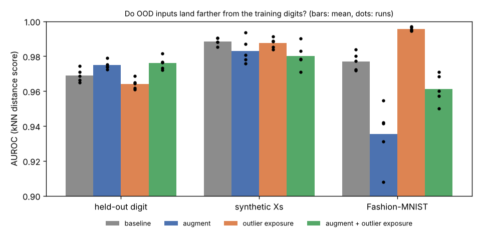
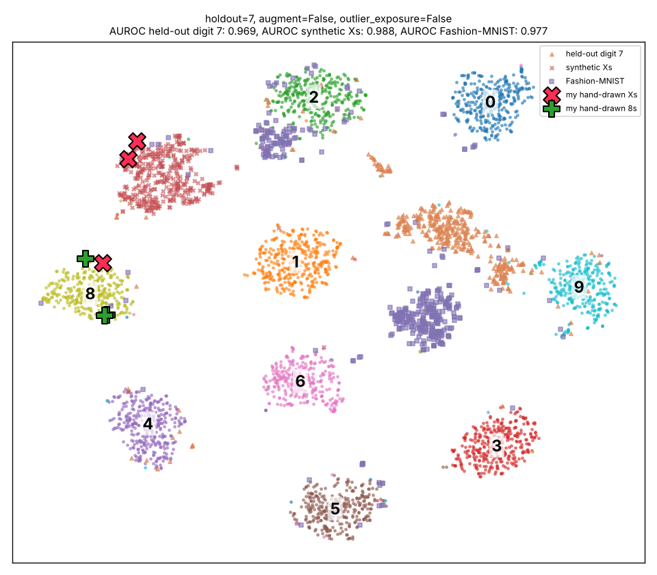
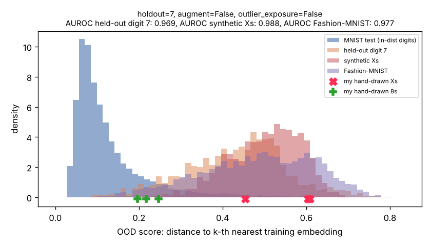

# triplet_loss_playground

Train a triplet-loss embedding on MNIST digits, then ask: **do out-of-distribution (OOD) inputs —
things that aren't digits, or digits the model never saw — land somewhere *different* in embedding space?**

Based on https://www.tensorflow.org/addons/tutorials/losses_triplet

Also see https://youtu.be/AwQHqWyHRpU?t=1450

## Setup and running

Uses [uv](https://docs.astral.sh/uv/):

```bash
uv sync
```

```bash
uv run src/experiment.py --holdout-digit 7 --augment --outlier-exposure
```

```bash
./run_all.sh
```

`experiment.py` trains on every MNIST digit except `--holdout-digit`, then writes `metrics.json`,
`tsne.png`, `scores.png` and `examples.png` to `results/<run name>/`. `run_all.sh` sweeps the
conditions below for a few held-out digits and calls `src/compare.py`, which writes
`results/summary.md` and `results/auroc_summary.png`.

With an NVIDIA GPU, use the `gpu` extra (`uv sync --extra gpu`), or Docker:

```bash
sudo docker build ~/triplet_loss_playground --tag=triplet_loss_playground
sudo docker run --gpus all -it -v ~/triplet_loss_playground:/home/triplet_loss_playground triplet_loss_playground uv run src/experiment.py
```

## The experiment

**OOD score:** distance from an input's (unit-norm) embedding to its k-th nearest *training*
embedding (k=10), as in [Sun et al. 2022](https://arxiv.org/abs/2204.06507). We report AUROC for
separating MNIST test digits (in-distribution) from each OOD set:

| OOD set | what it tests |
|---|---|
| held-out MNIST digit (~1000 images) | near-OOD: a digit class never seen in training |
| 2000 synthetic hand-drawn-style Xs (`src/data.py`), preprocessed exactly like MNIST | near-OOD: same pen strokes, not a digit |
| Fashion-MNIST | far-OOD sanity check |
| my three hand-drawn Xs in `new_images/` | reported as a percentile vs. MNIST test digits |
| my three hand-drawn 8s in `new_images/` | control: should look in-distribution |

**Conditions:**

- **baseline:** small CNN (the original architecture) with semi-hard triplet loss (`src/triplet.py`,
  a port of the now-deprecated TF Addons loss)
- **`--augment`:** random rotation (±15°), shift (±10%) and zoom (±10%) during training
- **`--outlier-exposure`:** "digit mashups" added to training, built from the top or left half of one digit
  glued to the bottom or right half of a digit from a different class. Each mashup gets a **unique label**, so the
  triplet loss never pulls mashups together; it only pushes each one away from every digit cluster.

## Results

20 runs: held-out digits 4, 7 and 9 × 4 conditions, plus seeds 1 and 2 for every held-out-7 condition.
Each run is 12 epochs at batch size 128 on CPU, about 4 minutes of training. The full table is in
[`results/summary.md`](results/summary.md).

| condition | runs | kNN acc (in-dist) | AUROC held-out digit | AUROC synthetic Xs | AUROC Fashion-MNIST | my Xs: percentile | my 8s: percentile |
|---|---|---|---|---|---|---|---|
| baseline | 5 | 0.990 ± 0.001 | 0.969 ± 0.004 | **0.988** ± 0.002 | 0.977 ± 0.005 | 99 ± 1 | 92 ± 3 |
| augment | 5 | 0.987 ± 0.001 | 0.975 ± 0.002 | 0.983 ± 0.007 | 0.935 ± 0.017 | 98 ± 1 | 90 ± 8 |
| outlier exposure | 5 | 0.990 ± 0.001 | 0.964 ± 0.003 | 0.987 ± 0.003 | **0.996** ± 0.001 | 99 ± 0 | 97 ± 2 |
| augment + outlier exposure | 5 | 0.988 ± 0.001 | **0.976** ± 0.004 | 0.980 ± 0.007 | 0.961 ± 0.008 | 98 ± 1 | 94 ± 1 |







### What we learned

1. **It works much better than the 2022 result suggested.** Even the plain baseline puts OOD inputs
   somewhere different. AUROC is 0.97 for a never-seen digit and 0.99 for synthetic Xs, and in the
   t-SNE plots the synthetic Xs form their own cluster. Your three hand-drawn Xs land in that cluster
   and are farther from the training digits than 94–100% of MNIST test digits in *every* run. The
   earlier "not cleanly" verdict mostly came from n=3 and from comparing raw distances to the test set
   without a reference distribution.
2. **The detector flags "not like MNIST", not "not a digit".** Your hand-drawn 8s are classified
   correctly (their nearest neighbors are 8s), yet they score at the 75th–100th percentile: they are
   noticeably farther out than typical MNIST 8s. They were drawn directly at 28×28, with thinner,
   more uniform strokes than MNIST's anti-aliased, 20×20-box-and-recentered digits, so a style or
   preprocessing shift looks partly like novelty. Your Xs still average higher than your 8s in all
   20 runs. The baseline separates them cleanly (every X above every 8) in **5 of 5** runs, with
   mean scores of about 0.52–0.62 for the Xs vs. 0.22–0.35 for the 8s. So on your own drawings,
   the original question now gets a yes, at least with n=3 + 3.
3. **Augmentation helps a little on the held-out digit (+0.006) and hurts on everything else.** It cuts
   Fashion-MNIST AUROC by about 0.04 and makes the score noisier across seeds. Invariance cuts both
   ways: a model trained to forgive shifts, rotations and blur also forgives things that aren't digits.
   It didn't consistently make your hand-drawn 8s look more in-distribution either (90 ± 8 vs. 92 ± 3).
4. **Outlier exposure with digit mashups fixes far-OOD but not near-OOD.** Fashion-MNIST goes from
   0.977 to 0.996, the held-out digit gets slightly worse (0.964), and your hand-drawn 8s look *more*
   OOD (97th percentile). The clean split between your Xs and your 8s disappears (0 of 5 runs).
   Mashups seem to teach "does this look exactly like an MNIST digit" rather
   than "is this a digit shape", which makes the model stricter in general, including toward
   slightly different 8s.
5. **None of the changes beat the baseline on Xs.** Synthetic Xs are already at 0.99 AUROC, and on
   your own drawings the baseline is the most reliable condition. For "is this one of the 10
   things I trained on?", the simplest setup was the best one here.

Run-to-run noise (3 seeds, held-out 7) is about ±0.003 AUROC, so the effects above are well outside
the noise. The exception is the augmentation effect on hand-drawn 8s.

Note: these runs used about 13.3k mashups for `--n-outliers 15000`, because same-class pairs were
dropped. That was fixed afterward (pairs are now resampled), so new runs get the full count.

### Ideas for next steps

- **Test the style-shift explanation:** run the hand-drawn images through `data.mnist_style_normalize`
  and see whether the 8s move back in-distribution and the Xs stay out.
- **A harder near-OOD set:** EMNIST letters (especially X, K, Y) or other shapes. The synthetic Xs
  may be too easy.
- **Is triplet loss doing anything special here?** Compare against a plain softmax classifier's
  penultimate-layer embedding with the same kNN score, and against max-softmax probability.
- **Class-conditional scores** (e.g. Mahalanobis distance to the nearest class), larger
  `--embedding-dim`, and a different `--margin`.

## History

The first version of this repo (April 2022) trained on all 10 digits with TF Addons and compared
three hand-drawn Xs to the MNIST test set. The Xs' nearest-neighbor distances (0.35–0.46) fell
inside the range of three hand-drawn 8s (0.19–0.53), and their nearest digits were 6, 8, 8. So that
version gave no clean OOD separation. See commit `8229cf9` for the original script and output.
